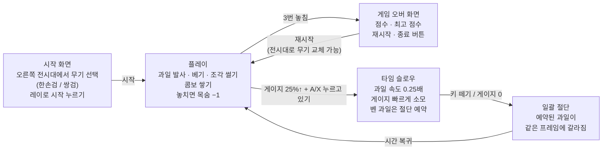

# 타임 슬래셔 (Time Slasher) — XR 컨셉 기획서

> 작성일: 2026-11-15 · 수정일: 2026-11-16 · 주제 B. XR Interaction Toolkit을 활용한 VR 게임

---

## 1. 개요

**타임 슬래셔**는 눈앞으로 솟아오르는 과일을 칼로 휘둘러 베는 VR 액션 게임이다. 시작할 때 긴 한손검과 짧은 쌍검 중 하나를 골라 들고, 과일을 3번 놓치면 게임이 끝난다.

| 항목 | 내용 |
| --- | --- |
| 앱 이름 | 타임 슬래셔 (Time Slasher) |
| 한 줄 소개 | 솟아오르는 과일을 휘두른 궤적 그대로 베고, 시간을 늦춰 한 번에 갈라내는 VR 베기 게임 |
| 선택 주제 | 주제 B. XR Interaction Toolkit을 활용한 VR 게임 |
| 플랫폼 | Meta Quest (Android APK) |
| 개발 환경 | Unity 6000.3, OpenXR + Unity OpenXR: Meta, XR Interaction Toolkit 3.5 |
| 플레이 방식 | 제자리에 서서 플레이 (이동 없음), 무기에 따라 한 손 또는 양손 사용 |
| 결과 표시 | 점수 + 승패 (3회 놓치면 패배) |
| 일정 | 11월 16일 컨셉 기획서 제출 · 개발 3일 · 11월 23일 1차 빌드 및 시연 영상 제출 |

---

## 2. 핵심 경험

이 앱이 확실히 해내는 한 가지는 **"내 팔로 휘두른 궤적 그대로 과일이 갈라진다"**는 감각이다. 손가락 스와이프로 하던 모바일 베기 게임을 실제 팔 동작으로 바꾸고, 리듬 게임처럼 팔을 크게 휘두르게 만든다.

- **베는 맛**: 미리 정해진 모양으로 쪼개지지 않는다. 과일의 **어디를, 어느 방향으로** 베었는지에 따라 실제로 그 평면대로 갈라진다. 가운데를 베면 반반, 가장자리를 스치면 얇은 조각이 떨어져 나간다. 진동·소리·과즙 파티클이 함께 터진다.
- **썰어내는 맛**: 갈라진 조각을 다시 베어 더 잘게 썰 수 있고, 벨 때마다 콤보가 올라간다.
- **블레이드 타임 (시간을 늦추는 순간)**: 버튼을 누르고 있는 동안 과일만 느려지고, 그 사이 여러 개를 베어 두었다가 버튼을 떼는 순간 모두 **같은 순간에 한꺼번에** 갈라지는 연출이 게임의 하이라이트다.
- **무기 선택**: 리치가 긴 한손검과 양쪽을 동시에 막는 쌍검 중 하나를 골라, 같은 게임을 다른 손맛으로 즐긴다.
- **긴장감**: 놓친 과일이 바닥에 떨어져 튕길 때마다 목숨 아이콘이 하나씩 사라져 끝까지 집중하게 된다.

플레이어는 제자리에 서서 하므로 연속 이동이나 카메라 강제 이동이 없어 멀미 걱정이 적다.

---

## 3. 게임 규칙

과일은 플레이어 앞 바닥에서 솟아올랐다가 포물선을 그리며 떨어지고, 베지 못하고 바닥에 떨어지면 목숨이 1 줄어든다. 목숨은 3개이고, **3번 놓치면 패배**다.

### 3-1. 과일 발사

- 플레이어는 움직일 수 없으므로, 과일은 칼이 닿는 곳을 반드시 지나가게 던진다. 발사 패턴은 두 가지이고 섞어서 나온다.
  - **솟아오름 (Rise)**: 플레이어 **가까이**(약 0.6~1.0m 앞) 바닥 아래에서 수직으로 올라갔다가 그대로 떨어진다. 올라갈 때와 떨어질 때 두 번 벨 기회가 있다.
  - **토스 (Toss)**: **멀리**(약 2~3m 앞) 바닥 아래에서 솟아올라, 플레이어 앞 **타격 존**(0.6~1.0m 앞, 좌우 ±0.5m, 높이 1.1~1.7m)에서 최고점이 되도록 플레이어 쪽으로 토스된다.
- 패턴마다 플레이어와의 생성 거리(최소·최대)를 인스펙터 값으로 따로 조절한다.
- 최고점 높이 h로 위쪽 속도(`vy = √(2gh)`)와 최고점까지 시간(`t = vy/g`)을 구하고, 수평 거리를 t로 나눠 수평 속도를 정한 뒤 `AddForce`로 발사한다. 솟아오름은 수평 거리가 0이라 수직으로 올라간다.
- 한 번에 1~4개가 동시에 올라오고, 시간이 지날수록 발사 간격이 짧아지고 개수가 늘어난다.
- 과일은 바닥 위로 완전히 올라온 뒤부터 바닥과 충돌한다. 놓친 과일은 바닥에 떨어져 튕기고 구르다가 사라진다.
- **(확장 목표) 투구 패턴**: 전방 12~15m에서 야구공처럼 포물선을 그리며 플레이어 쪽 타격 존으로 날아온다. T초 뒤 같은 타격 존에 도착하도록 초속도를 역산하고, 베지 못하고 플레이어 뒤로 완전히 넘어가면 목숨이 1 줄어든다. 바닥 발사를 먼저 완성한 뒤 시간이 남으면 추가한다. (코드는 `FruitSpawner`의 `LaunchPattern`으로 미리 넣어 두어 바닥 / 투구 / 섞기를 고를 수 있다.)

### 3-2. 무기

플레이어 **오른쪽 전시대**에 두 종류의 무기가 진열되어 있다. 진열된 무기를 레이로 가리키고 트리거를 당기면(또는 손으로 눌러 고르면) **손에 든 무기가 그 무기로 바뀐다.** 무기는 처음부터 컨트롤러에 붙어 있어 놓치거나 떨어뜨릴 일이 없다. 고른 뒤 시작 버튼을 누르면 게임이 시작된다.

| | 긴 한손검 | 짧은 쌍검 |
| --- | --- | --- |
| 구성 | 1자루 (한 손) | 2자루 (양손에 하나씩) |
| 칼날 길이 | 약 1.0m | 약 0.55m × 2 |
| 장점 | 넓은 리치, 한 번 휘두르기로 여러 개 베기 쉬움 | 양쪽에서 오는 과일을 동시에 처리 |

- 두 무기의 차이는 칼날 길이와 손 개수뿐이고, 점수 배율 같은 별도 보정은 두지 않는다.
- 게임 오버 화면에서도 전시대로 무기를 바꿀 수 있고, 재시작을 누르면 바꾼 무기로 바로 다시 시작한다. 게임 중에는 바꿀 수 없다.
- 직접 집어 드는 방식(Grab + Socket) 대신 전시대 선택 방식을 쓴 이유: 칼을 놓치거나 떨어뜨리는 문제, 쌍검을 두 번 집어야 하는 번거로움, 손과 칼 사이의 지연이 모두 사라지고, 시연 영상에서도 무기 교체가 한 번에 보인다.

### 3-3. 베기 판정과 절단

- 칼마다 판정을 따로 계산한다. 쌍검이면 왼손·오른손이 각각 판정해 양쪽에서 오는 과일을 동시에 처리할 수 있다.
- **칼날에 닿으면 속도와 관계없이 무조건 베인다.** 칼을 휘둘러 베는 것은 물론, 날아오는 과일의 길목에 칼을 갖다 대기만 해도 갈라진다.
- **자른 면은 칼날이 실제로 지나간 평면**이다. 칼날이 과일에 닿은 위치를 지나고, 칼날 방향과 칼·과일이 서로 움직인 방향이 만드는 평면으로 과일 메시를 실시간으로 자른다. 칼과 과일이 거의 움직이지 않은 상태로 닿으면 칼날 면을 따라 자른다. 단면에는 과일마다 다른 과육 머티리얼이 입혀진다.
- 갈라진 조각은 원래 과일이 날아가던 속도를 이어받아 양쪽으로 벌어지며 날아가고, 바닥에 떨어지면 튕기고 구르다 2초 뒤 사라진다.
- **조각도 다시 벨 수 있다.** 평상시든 타임 슬로우 중이든 같은 규칙이다.
  - 한 과일당 최대 3번까지 자를 수 있다 (최대 8조각).
  - 반지름 3cm 미만의 작은 조각은 더 이상 벨 수 없다.
  - 방금 베인 물체와 새로 생긴 조각은 0.2초 동안 다시 베이지 않는다. 한 번 칼이 닿았을 때 같은 과일이 연달아 여러 번 잘리는 것을 막기 위해서다.

### 3-4. 점수, 콤보, 목숨

모든 절단은 콤보를 1 올리고, 점수는 **과일을 처음 벨 때만** 콤보 배율을 곱해 얻는다. 조각을 다시 베는 것은 점수 대신 콤보를 올려, 다음 과일을 높은 배율로 베게 해준다.

| 상황 | 결과 |
| --- | --- |
| 과일 첫 절단 | `10점 × 콤보 배율` (타임 슬로우 중이면 추가로 ×2), 콤보 +1, 게이지 +10% |
| 조각 추가 절단 | 점수 없음, 콤보 +1 |
| 과일을 바닥에 떨어뜨림 | 목숨 −1, 콤보 초기화 |
| 2초 동안 아무것도 베지 못함 | 콤보 초기화 (과일 시간 기준이라 슬로우 중에는 끊기지 않음) |
| 목숨 0 | 게임 오버 → 결과 화면 |

| 콤보 | 0~4 | 5~9 | 10~19 | 20 이상 |
| --- | --- | --- | --- | --- |
| 배율 | ×1 | ×1.5 | ×2 | ×3 |

- 현재 콤보 수와 배율은 점수판 옆에 크게 띄운다.
- 목숨은 HUD 왼쪽 위에 아이콘 3개로 보여주고, 놓칠 때마다 하나씩 사라진다. 점수는 오른쪽 위, 콤보는 그 아래에 띄운다.
- 수치(배율 구간, 2초, 10점)는 플레이 테스트로 조정한다.

---

## 4. 특수능력: 블레이드 타임 (Blade Time · 게이지형 · 누르고 있는 동안 발동)

과일을 베어 게이지를 모으고, **슬로우 키를 누르고 있는 동안만** 과일이 느려진다. 누르는 동안 게이지가 매우 빠르게 줄어들어, 짧고 굵게 쓰는 능력이 된다. 그동안 벤 과일은 즉시 갈라지지 않고, 키를 떼거나 게이지가 바닥나는 순간 모두 같은 순간에 갈라진다.

| 항목 | 내용 |
| --- | --- |
| 게이지 충전 | 평상시에 과일을 처음 벨 때마다 10%씩 충전, 10개를 베면 가득 참. 조각 추가 절단과 슬로우 중 절단으로는 충전되지 않음 |
| 발동 | 슬로우 키(**A 또는 X 버튼**, 어느 손이든)를 누르고 있는 동안. 게이지가 25% 이상일 때만 시작 가능 |
| 효과 | 과일과 조각의 시간 배율 1.0 → 0.25 (4배 느리게). 키를 누르는 즉시 전환 |
| 게이지 소모 | 누르고 있는 동안 실제 시간 기준으로 빠르게 소모. 가득 찬 게이지로 최대 약 3초 (수치는 플레이 테스트로 조정) |
| 종료 | 키를 떼거나 게이지가 0이 되면 즉시 종료. 남은 게이지는 유지되어 다음에 이어 쓸 수 있음 |
| 베기 처리 | 칼이 지나간 과일에 빛나는 절단선만 남고, 두 조각으로 나뉘지 않음 (예약 상태). 같은 과일을 여러 번 베면 절단선이 겹겹이 쌓임 (최대 3번) |
| 바닥에 닿은 예약 과일 | 바닥에 닿는 순간 먼저 갈라지고, 조각은 느린 상태로 튕김. 목숨은 줄지 않으며 작은 효과만 냄 |
| 종료 연출 | 시간이 원래대로 돌아오는 순간 예약된 과일이 **모두 같은 프레임에** 갈라짐. 큰 효과음 1회 + 양손 강한 진동 1회 + 짧은 흰 플래시, "×N SLASH" 합산 표시 |
| 점수 | 슬로우 중 처음 벤 과일은 점수 ×2. 절단마다 콤보 +1 |

**게이지 표시**: HUD 아래 가운데에 가로 바 게이지를 띄운다. 차는 동안은 파란색이고, 25% 이상이 되면 밝아지며 "A/X 누르고 있기" 안내가 뜬다. 슬로우 중에는 바가 빠르게 줄어드는 모습이 그대로 보여 남은 시간을 직관적으로 알 수 있다. 게이지가 25% 미만일 때 키를 누르면 발동하지 않는다.

**UI 구성**: 누를 수 있는 화면(시작 화면, 게임 오버 화면)은 플레이어 정면 2m 월드 공간에 띄우고 레이 + 트리거로 누른다. 플레이 중 정보(목숨, 점수·콤보, 게이지, 일괄 절단 연출)는 시야에 붙어 따라다니는 HUD로 보여주고 누를 수 없다. (Screen Space Overlay는 헤드셋에 보이지 않아, 카메라 앞 1m에 붙인 판으로 만든다.)

- **느려지는 것은 과일과 조각뿐이다.** 플레이어의 손과 칼은 원래 속도로 움직여서, 느린 세상 속에서 나만 빠른 느낌을 준다. 그래서 전역 `Time.timeScale` 대신 과일만 들어 있는 물리 세계를 따로 만들어 그 세계의 시간만 느리게 흘린다.
- 누르는 동안만 발동하므로, 플레이어가 원하는 타이밍에 직접 일괄 절단을 터뜨릴 수 있다.
- 예약된 과일은 이미 벤 것으로 처리해, 슬로우가 끝나기 전에 바닥에 닿아도 목숨이 줄지 않는다.
- 슬로우 동안 화면 가장자리에 푸른 비네팅을 주고 배경음을 낮게 끌어내려, 시간이 느려졌다는 것을 한눈에 알게 한다.
- 슬로우 중에도 새 과일은 계속 느리게 발사돼, 더 많이 모아 벨수록 마무리 연출이 커진다.

---

## 5. 조작과 사용 XR 기능

| 동작 | 조작 | 사용 XR 기능 |
| --- | --- | --- |
| 무기 선택 | 오른쪽 전시대의 한손검 또는 쌍검을 레이로 가리키고 트리거 → 손의 무기가 바뀜 | XRI `XRSimpleInteractable` (Select Entered 이벤트) + `NearFarInteractor` |
| 베기 | 팔을 휘두르거나 칼을 갖다 대어 칼날이 과일에 닿음 | 컨트롤러 트래킹 + 물리 판정(`Raycast`, `OverlapCapsule`) |
| 타임 슬로우 | A 또는 X 버튼을 누르고 있기 (게이지 25% 이상일 때) | Input System 액션 |
| 시작 / 재시작 / 종료 | 레이로 정면 UI 버튼 누르기 | XRI `XRRayInteractor` + World Space UI |
| 타격감 | 벨 때 해당 손 진동 | XRI 햅틱 (`HapticImpulsePlayer`) |

- 무기는 양손 컨트롤러의 자식으로 미리 붙여두고, 고른 무기만 켠다. 그립을 쥐고 있을 필요가 없고 칼이 손을 지연 없이 따라온다.
- 플레이 중에는 레이를 감추고, 시작·결과 화면에서만 레이를 보여준다.
- 이동·회전은 쓰지 않는다. 필요하면 스냅 회전만 켜둔다.

---

## 6. 게임 흐름

시작 → 플레이 → 결과의 한 판 구조이고, 플레이 중에는 게이지가 남아 있는 한 타임 슬로우를 몇 번이든 쓸 수 있다.



1. **시작 화면**: 앱 이름과 제작자 이름을 띄우고, 오른쪽 전시대에서 원하는 무기를 레이로 고른 뒤 시작 버튼을 누른다. 과일은 플레이어 정면에서 솟아오른다.
2. **플레이**: 과일이 계속 솟아오르고, 과일과 조각을 벨 때마다 콤보가 쌓이며 점수와 게이지가 오른다.
3. **타임 슬로우**: 게이지가 25% 이상일 때 A/X를 누르고 있으면 발동하고, 키를 떼거나 게이지가 바닥나면 일괄 절단 후 플레이로 돌아간다.
4. **게임 오버 화면**: 3번 놓치면 게임 오버. 최종 점수와 최고 점수를 보여주고, 재시작으로 바로 다시 하거나 종료한다. 재시작 전에 전시대에서 무기를 바꿀 수 있다.

플레이 1판은 1~3분 정도로 잡아, 시연 영상에 시작 → 슬로우 연출 → 게임 오버까지 모두 담기게 한다.

---

## 7. 구현 설계와 일정

첫날 "베기가 기분 좋게 된다"를 완성한 뒤 타임 슬로우와 연출을 차례로 얹고, UI는 AI로 만들어 시간을 아낀다. 세부 설계는 `Docs/시스템구조.md`에 정리한다.

**코드 원칙**: 누가 읽어도 바로 이해되는 단순한 코드를 목표로 하고, 수업에서 직접 만든 게임(Merge Game, Mini Golf, AirPlane Game 등)에서 쓴 패턴을 그대로 가져온다. 직접 만드는 스크립트는 7개이고, 스크립트끼리는 약식 싱글톤(`GameManager.Instance`, `BladeTimeController.Instance`, `FruitWorld.Instance`)으로만 연결한다. 발사는 Mini Golf의 `GolfBall`처럼 요청을 받아 `FixedUpdate`에서 `AddForce`하고, 바닥 충돌은 `OnCollisionEnter`에서 `LayerMask`로 검사한다. 모양이 늘 같은 과일과 과즙 파티클은 FPS Game에서 만든 오브젝트 풀(`IObjectPoolItem`, `ObjectPoolManager`)을 수정 없이 가져와 재사용하고, 자를 때마다 모양이 다른 조각은 `Instantiate`로 만들고 `Destroy`로 지운다. 상태 머신·새 인터페이스·이벤트는 3일 일정에 비해 코드가 길어져 쓰지 않는다. 수학 공식이 필요한 부분은 짧은 함수로 따로 빼서 AI로 작성한다.

### 7-1. 주요 스크립트

| 스크립트 | 역할 |
| --- | --- |
| `GameManager` | 상태(대기·플레이·종료), 점수, 콤보, 목숨, 슬로우 중 벤 과일 목록과 일괄 절단 |
| `FruitSpawner` | 오브젝트 풀에서 과일을 꺼내 바닥 아래에 놓고 `AddForce`로 발사. 시간이 지날수록 간격이 짧아지고 개수가 늘어남 |
| `Fruit` | 과일과 잘린 조각이 **같이 쓰는** 스크립트 (`IObjectPoolItem` 구현). 발사, 베이기(즉시 또는 숨겨두기), 바닥 충돌(놓침·튕김). 과일은 풀로 반납, 조각은 바닥에 닿고 2초 뒤 삭제 |
| `Blade` | 칼 1자루당 1개 (쌍검이면 2개). 칼날에 닿은 과일을 찾아 `Fruit.Cut(위치, 방향)` 호출, 벤 손 진동 |
| `BladeTimeController` | A/X 누르고 있기 입력, 게이지 충전·소모, 시간 배율 전환, 비네팅 |
| `FruitWorld` | 과일 전용 물리 씬을 만들고, 매 물리 스텝마다 `실제 시간 × 배율`만큼 진행 (슬로우의 핵심) |
| `GameUI` | 시작·게임 오버 화면(월드), 목숨·점수·콤보·게이지(HUD)를 매 프레임 표시. 화면 자체는 에디터 도구 `GameUIBuilder`가 코드로 조립 |

전시대의 무기 선택은 `XRSimpleInteractable`의 Select Entered 이벤트에 `GameManager.SelectLongSword()` / `SelectDualSwords()`를 인스펙터에서 연결해 만든다. XR 수업의 `QuestButtons`, `SceneTimestep`, FPS Game의 `IObjectPoolItem`, `ObjectPoolManager`, `ParticleEffect`, Utils의 `LayerMaskExtensions`는 수정 없이 복사해 쓴다.

### 7-2. 핵심 기술 결정

**과일만 느려지게 하기 (과일 전용 물리 씬)**

`Time.timeScale`을 바꾸면 플레이어 손과 칼까지 느려진다. 그래서 **과일·조각·바닥 콜라이더만 들어 있는 물리 세계(PhysicsScene)를 따로 만들고, 그 세계의 시간만 직접 흘려준다.**

```csharp
// 매 물리 스텝마다 과일 세계를 "실제 시간 × 배율"만큼만 진행 (평소 1, 슬로우 0.25)
fruitPhysics.Simulate(Time.fixedDeltaTime * BladeTimeController.Instance.Scale);
```

- 과일 세계 안에서는 중력·튕김·마찰·멈춤 판정이 평소와 **완전히 똑같이** 계산되고, 진행 속도만 느려진다. 과일에만 `timeScale`을 건 것과 같다.
- 과일 코드에는 슬로우 처리가 없다. Rigidbody의 Use Gravity를 그대로 켜고 평소처럼 `AddForce`로 발사한다.
- 플레이어와 칼은 원래 세계에 있으므로 정상 속도로 움직인다.
- 발사 간격과 콤보 타이머는 `Time.deltaTime × 배율`로 과일 시간에 맞춘다.

**베기 판정 (Unity 물리 함수 사용)**

칼날 시작점·끝점 두 위치로, XRI가 칼을 손에 맞춘 뒤인 `LateUpdate`에서 매 프레임 두 가지를 검사한다.

| 상황 | 방법 |
| --- | --- |
| 휘두를 때 | 칼날 위 5개 점이 지난 프레임 → 이번 프레임으로 이동한 선을 `Raycast`로 검사. 빠르게 휘둘러도 과일을 지나치지 않음 |
| 가만히 대고 있을 때 | 칼날을 캡슐로 보고 `OverlapCapsule`로 닿아 있는 과일 검사. 과일은 과일 전용 물리 씬에 있으므로 두 검사 모두 그 씬의 `PhysicsScene`으로 한다 |

- 닿으면 속도와 관계없이 벤다.
- 자르는 방향은 `칼날 방향 × 칼이 움직인 방향`으로 구한다. 칼이 거의 안 움직였거나 찌르듯 칼날 방향으로 움직였으면 칼날 면 방향으로 자른다.
- 같은 과일이 한 프레임에 여러 번 베이는 것은 "베인 직후 0.2초 동안 안 베임" 규칙 하나로 막는다.

**실시간 메시 절단 (EzySlice)**

- **평상시**: 닿은 위치·방향으로 과일 메시를 바로 잘라 메시 2개를 만들고, 조각 프리팹(Rigidbody, SphereCollider, `Fruit` 조각 모드)을 생성해 넣는다. 원래 과일은 풀로 돌려보낸다. 조각도 `Fruit`이라 다시 벨 수 있다.
- **타임 슬로우 중**: 그 자리에서 바로 자르되 **조각을 과일의 자식으로 숨겨둔다**. 과일은 빗금만 그어진 채 그대로 날아가고, 숨겨둔 조각도 자식이라 함께 움직인다. 같은 과일을 또 베면 숨겨둔 조각들을 다시 자른다.
- **슬로우 해제 순간**: 숨겨둔 조각을 모두 보이게 하고 원래 과일을 풀로 돌려보낸다. 메시 계산은 이미 끝나 있어서, 많은 과일이 같은 프레임에 갈라져도 부담이 거의 없다.

**바닥 충돌**

| 레이어 | 충돌 대상 |
| --- | --- |
| FruitRising (발사 직후) | 없음 (바닥 아래 발사대를 통과하기 위해) |
| Fruit (바닥 위로 올라온 과일, 모든 조각) | Floor |
| Floor | Fruit |

- 과일끼리는 서로 충돌하지 않는다 (공중에서 궤적이 망가지는 것 방지).
- 바닥 충돌은 `OnCollisionEnter`에서 부딪힌 오브젝트의 레이어가 `floorMask`(Floor)에 포함되는지로 판단한다.
- 과일은 SphereCollider + Physic Material(탄성 약 0.3, 마찰 약 0.6)을 쓴다.
- 바닥은 두께 0.5m 정도의 BoxCollider로 만들어 빠르게 떨어지는 과일이 뚫고 지나가지 않게 한다.

### 7-3. 일정

| 날짜 | 목표 |
| --- | --- |
| 11/16 | 컨셉 기획서 제출 |
| 1일차 | 프로젝트 세팅(OpenXR·XRI, 레이어), 전시대와 무기 선택(한손검·쌍검), 과일 전용 물리 씬, 과일 발사와 포물선, 베기 판정, EzySlice 실시간 절단과 조각 다시 베기 |
| 2일차 | 점수·콤보·목숨·바닥 충돌 놓침·게임 오버, 게이지와 슬로우 키(누르고 있기), 타임 슬로우와 숨겨둔 조각 일괄 절단 |
| 3~4일차 | 연출(햅틱·파티클·사운드·비네팅·플래시), 시작·결과·게이지·콤보 UI 적용, (여유 시) 투구 패턴, Quest 빌드·녹화·제출 |

11월 23일 마감까지 남는 여유는 버그 수정 버퍼로 둔다.

### 7-4. 리스크와 대안

- **실시간 메시 절단이 Quest에서 무거울 수 있다** → 과일 모델은 닫힌 로우폴리 메시(약 300~1000 삼각형)를 쓰고 **Read/Write Enabled**를 켠다. 한 과일당 절단은 3번으로 제한하고, 슬로우 중 절단은 벨 때마다 바로 계산해 숨겨두므로 해제 순간에 몰리지 않는다.
- **생성된 메시가 쌓여 메모리가 샌다** → 조각을 삭제할 때 자를 때 만든 메시도 함께 직접 삭제한다.
- **풀에서 꺼낸 과일에 이전 상태가 남는다** → 꺼낼 때마다 `Init()`으로 속도·레이어·점수 여부를 초기화하고, 과일을 없앨 때 숨겨둔 조각도 함께 삭제한다.
- **빠르게 휘두르면 칼이 과일을 통과해 판정이 빠질 수 있다** → 칼날 위 여러 점의 지난 프레임 → 이번 프레임 이동을 `Raycast`로 검사한다.
- **같은 과일이 한 번 닿았을 때 연달아 잘린다** → 베인 직후와 조각이 생긴 직후 0.2초 동안은 베이지 않게 한다.
- **칼이 손을 늦게 따라와 판정이 어긋날 수 있다** → 무기를 잡는 대신 컨트롤러 자식으로 붙여 손과 똑같이 움직이게 한다.
- **휘두르다 슬로우 키가 잘못 눌릴 수 있다** → 게이지 25% 미만에서는 발동하지 않고, 누르고 있는 동안만 유지되므로 실수로 눌러도 손을 떼면 바로 끝난다.
- **칼을 과일이 올라오는 자리에 대고만 있어도 계속 베일 수 있다** → 과일은 좌우로 넓게 흩어져 발사되어 한 자리에서 모두 막기 어렵다. 그래도 쉬워 보이면 발사 범위를 넓히거나 동시 발사 개수를 늘려 조정한다.
- **조각만 계속 베어 콤보와 게이지를 쉽게 쌓을 수 있다** → 조각 추가 절단은 점수와 게이지 없이 콤보만 올리고, 절단 횟수와 최소 조각 크기로 상한을 둔다.
- **파티클·조각이 쌓여 프레임이 떨어질 수 있다** → 과일·파티클은 오브젝트 풀로 재사용하고, 조각은 바닥에 닿고 2초 뒤 삭제하며, 한 과일당 최대 8조각으로 제한한다.
- **팔을 크게 휘두르다 실제 주변 물건을 칠 수 있다** → 시작 전 가디언 경계 안내를 띄우고, 과일은 팔 닿는 범위 안에서만 올라온다. 긴 한손검은 리치가 길어 특히 주의 안내를 띄운다.
